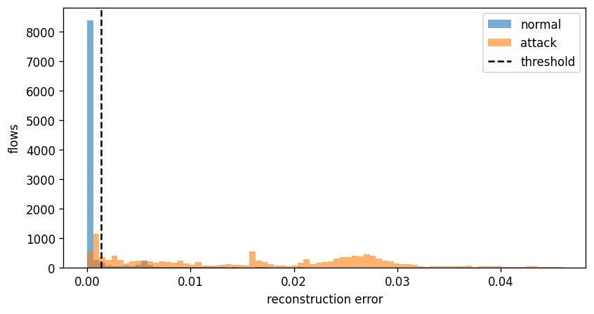

# PulseNet: real-time anomaly detection in network traffic

A PyTorch **autoencoder** trained only on *normal* network flows (NSL-KDD). Flows it cannot reconstruct well
are flagged as anomalies, and a FastAPI server streams the alerts to a live dashboard over WebSockets.

```
NSL-KDD flows -> preprocessing -> Autoencoder -> reconstruction error -> threshold -> alert
                                      (FastAPI /predict) ----WebSocket----> live dashboard
```

## Why this approach
Most students train a classifier on labelled attacks. Real systems can't label every future attack, so this
project learns what *normal* looks like and flags what deviates. The test file contains 17 attack types that
never appear in the training file, which makes it a fair check of that claim.

## Results (NSL-KDD test set, 22,544 flows)
Threshold = 95th percentile of reconstruction error on held-out **normal validation** data (the test set was not used to pick it).

| Model | Precision | Recall | F1 | ROC-AUC |
|---|---|---|---|---|
| **Autoencoder (PyTorch)** | 0.917 | 0.861 | 0.888 | **0.963** |
| Isolation Forest (baseline) | 0.973 | 0.684 | 0.803 | 0.945 |

Confusion matrix (autoencoder): 8,715 normal flows correct, 996 false alarms, 1,781 missed attacks, 11,052 attacks caught.



**Honest limitations**
- The threshold was set for about 5% false alarms on validation normals, but the false-alarm rate on the *test* normals is about 10%.
  The test file's normal traffic is harder than the training normals (a known property of NSL-KDD), so the threshold is a trade-off, not a guarantee.
- The "live" stream is a replay of recorded benchmark data, not captured network packets.
- One dataset (NSL-KDD, an old benchmark). Results on modern traffic would differ.

**Performance (CPU, sequential requests):** about 6 ms model latency per flow, about 120 flows/s through the full HTTP API.

## Project structure
```
data/raw/            KDDTrain+.txt, KDDTest+.txt
notebooks/           01_eda, 02_preprocess_train, 03_evaluate (already run, outputs included)
src/                 features.py (shared preprocessing), model.py (Autoencoder)
artifacts/           autoencoder.pth, scaler.joblib, metadata.json (columns, threshold, results)
app/                 main.py (API + WebSocket), inference.py, static/index.html (dashboard)
replay_stream.py     simulates live traffic
figures/             plots and results table
Dockerfile
```

## Run it
```bash
python -m venv venv && venv\Scripts\activate      # Mac/Linux: source venv/bin/activate
pip install -r requirements.txt

# 1. (optional) retrain: run notebooks 02 then 03 top to bottom. Artifacts are already included.
# 2. start the server
uvicorn app.main:app --port 8000
# 3. open http://localhost:8000 in the browser, then in a second terminal:
python replay_stream.py --mode normal      # calm
python replay_stream.py --mode attack      # red alerts
python replay_stream.py --mode mixed       # ~10% attacks
```
API docs: http://localhost:8000/docs

## Docker
```bash
docker build -t pulsenet .
docker run -p 8000:8000 pulsenet
```
Then open http://localhost:8000 and run `replay_stream.py` from your host machine.

## How it works (short)
1. **Preprocessing** (`src/features.py`): drop a constant column, `log1p` on three huge-range columns, one-hot encode 3 text columns (121 features), MinMax-scale. The scaler is fitted on normal training data only.
2. **Model** (`src/model.py`): 121 -> 64 -> 32 -> 16 -> 32 -> 64 -> 121, MSE loss, Adam, early stopping on validation loss.
3. **Scoring**: anomaly score = mean squared reconstruction error of a flow. Above the threshold = alert.
4. **Serving**: the model, scaler and column list are loaded once at startup. `/predict` scores a flow and broadcasts the result to every open dashboard.
